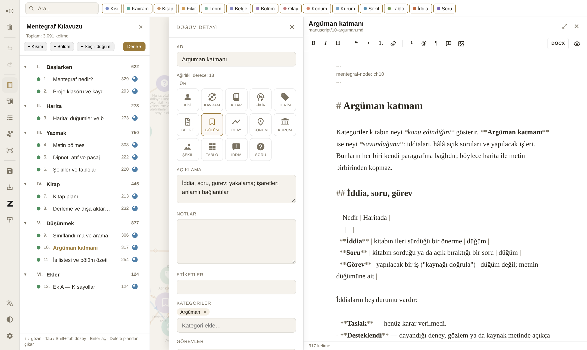

# Mentegraf nedir?

Mentegraf, uzun ve karmaşık bir metin üzerinde çalışan yazar ve araştırmacılar için bir **düşünme ve yazma ortamıdır**. Merkezinde bir harita var: kavramlar, kişiler, kitaplar, fikirler ve bölümler birer **düğüm**; aralarındaki ilişkiler birer **bağlantı**. Bu haritanın yanında metinlerinizi yazdığınız bir editör, kitabın sırasını tuttuğunuz bir kitap planı, konulara göre sınıflandırma ve kitabın neyi savunduğunu izleyen bir argüman katmanı bulunur.

Alışılmış yazı programları metni yukarıdan aşağıya bir hiyerarşi olarak düşünür. Mentegraf ise bilginin önce bir ağ olduğunu varsayar: aynı kavram birden çok bölümde geçer, bir kişi birden çok fikre bağlanır, bir iddia başka bir iddiayla çelişir. Hiyerarşi (kitabın bölüm sırası) bu ağın üzerine ayrıca kurulur.

{#fig:ana-ekran}

@fig:ana-ekran ana ekranı gösteriyor. Ekran dört bölgeden oluşur:

- **Sol araç çubuğu:** düğüm ekleme, silme, geri alma, kitap planı, sınıflandırma, iş listesi, düzen, kaydetme, dışa aktarma, Zotero, dil, tema ve ayarlar.
- **Sol bölme:** kitap planı, sınıflandırma ya da iş listesinden biri (aynı anda biri açık olur).
- **Harita:** ortadaki alan. Üst çubukta arama kutusu ve tür filtreleri vardır.
- **Sağ bölmeler:** bir düğüme tıklayınca açılan *düğüm paneli* ve düğümün metni açıkken *metin bölmesi*.

## Bu kılavuz da bir Mentegraf projesi

Okuduğunuz kılavuz Mentegraf'ın kendisiyle yazıldı. Her bölüm haritada bir düğüm, her özellik bir kavram; bölümler kitap planında sıralandı, konular sınıflandırıldı, kılavuzun ileri sürdüğü tasarım ilkeleri birer iddia olarak işaretlendi ve kitap **Derle** komutuyla Word ve EPUB'a dönüştürüldü. Kılavuzu Mentegraf'ta açarsanız, anlattığı her şeyi aynı anda çalışırken görebilirsiniz. ^ilke1

## Temel ilkeler

Mentegraf birkaç ilkeye dayanır; kılavuz boyunca bunların izini göreceksiniz:

- **Metinler sizindir.** Her metin sıradan bir Markdown dosyasıdır; Typora, Obsidian ya da herhangi bir editörde açılır. Mentegraf olmadan da okunur. ^ilke2
- **Proje bir klasördür.** Her düğüm ayrı bir küçük dosyadır; bu yüzden Seafile, Nextcloud ya da Git gibi araçlarla sorunsuz eşitlenir ve değişiklikler satır satır izlenebilir.
- **Harita yük olmamalı.** Bir iddiayı ya da görevi yakalamak tek bir tuş kadar kolay olmalı; harita metinden koptuğunda bunu siz aramadan size göstermelidir.
