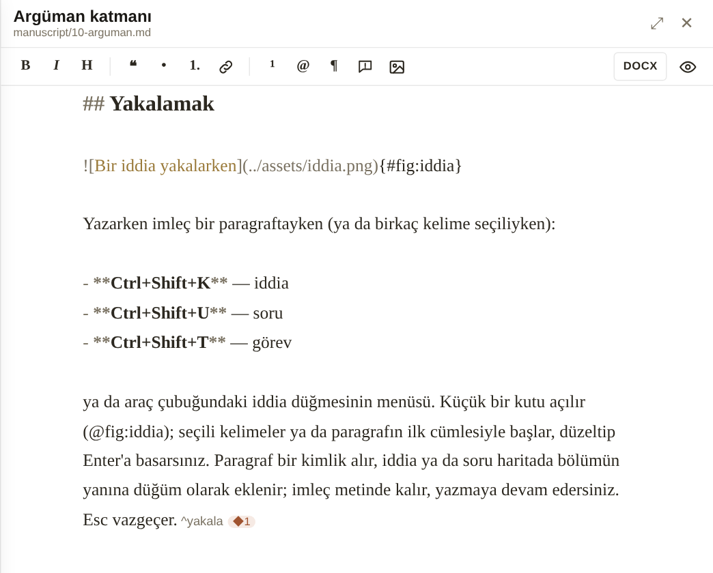

# Metin bölmesi

Haritadaki **her düğümün bir metni olabilir**: bir bölümün tam metni, bir kişi hakkındaki notlar, bir kavramın tanımı. Düğüm panelindeki **Metin oluştur** düğmesi düğüm için yeni bir Markdown dosyası açar; metni olan düğümlerde aynı düğme **Metni aç** olur. Bölüm türündeki düğümlerin metinleri `manuscript/`, diğerleri `notes/` klasörüne yazılır.

{#fig:metin-bolmesi}

Metin bölmesi haritanın sağında açılır (@fig:metin-bolmesi). Kenarından sürükleyerek genişletebilir, ⤢ ile tam genişliğe alabilirsiniz. Alt çubukta kelime sayısı ve kaydedilmemiş değişiklik uyarısı görünür. Metinler projeyle birlikte Ctrl+S ile kaydedilir.

## Markdown, ama görünmeden

Metin Markdown olarak saklanır ve öyle görünür: `#`, `**`, `_` gibi işaretler yerinde durur, ama başlıklar büyük, vurgular kalın ya da italik, dipnot ve atıf işaretleri renkli gösterilir. Böylece metnin ne olduğunu her zaman görürsünüz; dışa aktarımda bir sürpriz olmaz. WYSIWYG bir editör yoktur; işaretleri araç çubuğu ve kısayollar sizin yerinize koyar:

| Düğme | Kısayol | İş |
|---|---|---|
| **B** | Ctrl+B | kalın |
| *I* | Ctrl+I | italik |
| H | | başlık düzeyi |
| ❝ | | alıntı |
| • / 1. | | madde ya da numaralı liste (seçili birden çok satıra birlikte) |
| bağlantı | Ctrl+K | bağlantı |
| ¹ | Ctrl+Shift+F | dipnot |
| @ | Ctrl+Shift+C | atıf (Zotero) |
| ¶ | Ctrl+Shift+P | pasaj kimliği |
| görsel | Ctrl+Shift+G | şekil ya da tablo |
| iddia | Ctrl+Shift+K / U / T | iddia, soru, görev |
| göz | Ctrl+E | önizleme |

## Önizleme

Göz düğmesi (Ctrl+E) metni dizgi hâlinde gösterir: dipnotlar sayfa altında, şekiller numaralı başlıklarıyla, şekil atıfları "Şekil 3" olarak. Önizleme salt okunurdur; yazmaya dönmek için yeniden basın.

## Dışarıda düzenlemek

Metin dosyası Typora ya da Obsidian'da açıkken değiştirilirse Mentegraf bunu fark eder: metin bölmesinde açıksa yeni hâlini yükler, sizin kaydedilmemiş değişikliğiniz varsa ne yapacağınızı sorar. Bu sayede Mentegraf'ı yalnızca haritayı yönetmek için kullanıp yazmayı alıştığınız editörde sürdürebilirsiniz. ^disari

## Tek metni Word'e aktarmak

Araç çubuğundaki **DOCX** düğmesi açık metni Pandoc ile Word belgesine dönüştürür: dipnotlar gerçek Word dipnotu, atıflar seçtiğiniz stile göre biçimlenmiş, kaynakça en sonda. Bütün kitabı derlemek için *Derleme* bölümüne bakın.
