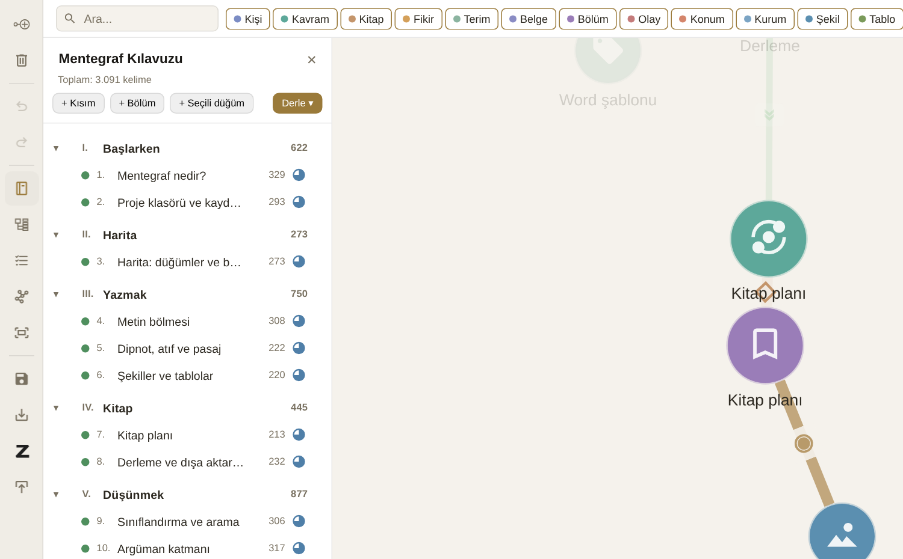

# Kitap planı

Harita bilginin nasıl bağlandığını gösterir; **kitap planı** ise okurun hangi sırayla okuyacağını. Sol araç çubuğundaki kitap düğmesi planı sol bölmede açar.

{#fig:kitap-plani}

## Kısımlar, bölümler, alt bölümler

Plan üç düzeyli bir ağaçtır (@fig:kitap-plani):

- **Kısımlar** yalnızca başlıktır (ör. "Kısım I — Temeller"); haritada karşılıkları yoktur.
- **Bölümler** ve **alt bölümler** haritadaki düğümlerdir. Yani bir bölüm, kavramlara ve kişilere bağlantılarını korur; planda nerede durduğu ile haritada neye bağlı olduğu ayrı şeylerdir.

**+ Kısım** ve **+ Bölüm** yeni öğe ekler; **+ Seçili düğüm** haritada seçtiğiniz düğümü plana katar. Öğeleri sürükleyerek sıralar, birini başka bir öğenin içine bırakarak alt bölüm yaparsınız.

## Klavye

Plan klavyeyle de yönetilir: ↑ ↓ gezinir, **Tab** öğeyi bir düzey içeri, **Shift+Tab** dışarı alır, **Enter** metnini açar, **Delete** plandan çıkarır (düğüm haritada kalır).

## Durum, hedef, ilerleme

Her bölümün bir **durumu** vardır: Fikir, Taslak, Gözden geçirme, Bitti. Durum, satırdaki küçük daire simgesiyle gösterilir ve tıklanarak değiştirilir. Düğüm panelinden bölüme bir **hedef kelime sayısı** verebilirsiniz; satırda yazılan ve hedeflenen kelime sayısı yan yana görünür, üst satırda kitabın toplamı yer alır.

Her satırın solundaki nokta bölümün derlemeye **dahil** olup olmadığını gösterir: yeşil dahil, gri hariç. Hariç tutulan bölüm planda kalır ama kitaba girmez; taslak hâlindeki ya da ayıklanmış bölümler için kullanışlıdır.

Planda bir bölüme tıklamak onu haritada seçer, komşularıyla birlikte öne çıkarır ve metnini açar.
