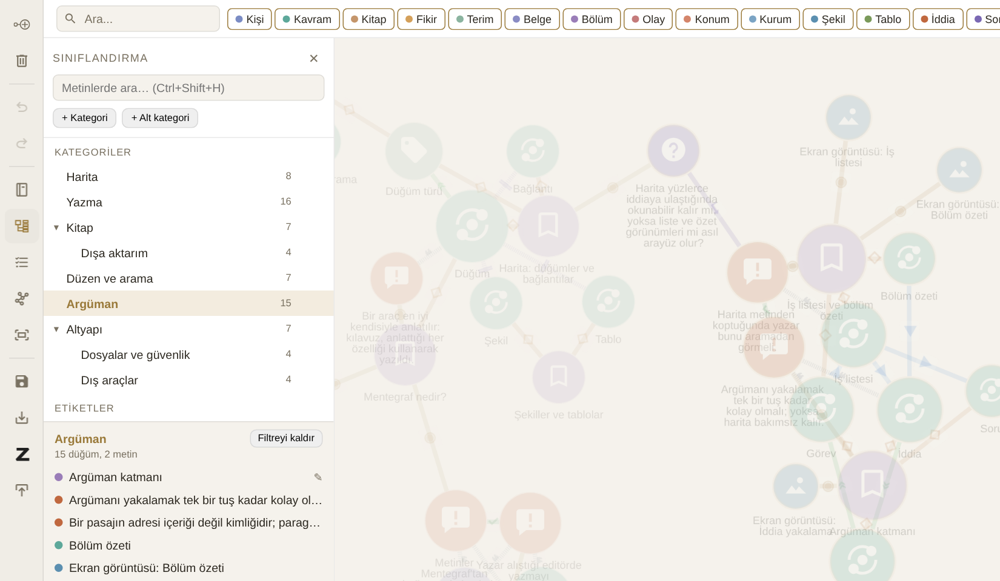
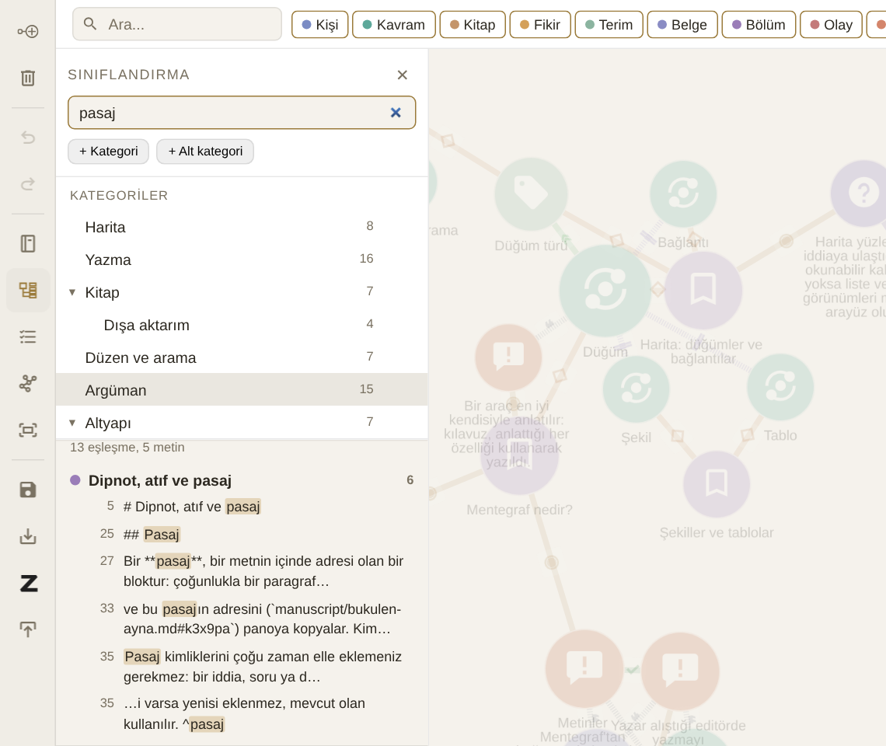

# Sınıflandırma ve arama

## Kategoriler

Düğüm türü bir şeyin *ne olduğunu* söyler (kişi, kavram, kitap). **Kategori** ise sizin kendi konu ağacınızda *nerede durduğunu*: "Sibernetik › Geri besleme" gibi. Bir düğüm birden çok kategoride olabilir; bir düğümün metni de düğümünün kategorilerini taşır.

{#fig:siniflandirma}

Sol araç çubuğundaki **Sınıflandırma** düğmesi bölmeyi açar (@fig:siniflandirma). Ağaç istediğiniz kadar derin olabilir; ilk iki düzey açık gelir, daha derin dallar ▸ ile açılır.

- **+ Kategori** en üst düzeye, satırın üzerindeki **+** alt kategori ekler.
- Çift tıklama yeniden adlandırır; sürükleyip bırakmak taşır.
- Sayılar alt kategorileri de içerir.
- Kullanılan bir kategoriyi silerken Mentegraf sorar; alt kategoriler bir üst düzeye taşınır.

Düğüme kategori vermek için düğüm panelindeki **Kategoriler** alanına adın bir kısmını yazın ve öneriyi seçin. Hiçbir kategori eşleşmezse Enter yeni bir kategori oluşturur.

## Etiketler

Etiketler düz, geçici işaretlerdir: `doğrulanacak`, `bölüm3-taslak` gibi. Düğüm panelinde virgülle ayrılarak yazılır, Sınıflandırma bölmesinde sayılarıyla listelenir.

## Filtre (mercek)

Bir kategoriye ya da etikete tıklamak **filtreyi** açar ve her yerde etkisini gösterir:

- Haritada eşleşmeyen her şey solar.
- Kitap planında dışarıda kalan bölümler sönükleşir.
- Bölmenin altında eşleşen düğümler listelenir; ✎ metni olanları gösterir.
- Açık metinde, eşleşen düğümlerin adının geçtiği satırlar ve bu kategorideki iddiaların paragrafları vurgulanır.

Aynı kategoriye yeniden tıklamak ya da **Filtreyi kaldır** filtreyi kapatır.

## Metinlerde arama

{#fig:arama}

**Ctrl+Shift+H** ya da bölmenin üstündeki kutu, projedeki bütün metinlerde arar (@fig:arama): `manuscript/` ve `notes/` klasörleri, kaydedilmemiş değişiklikler dahil.

- Büyük-küçük harf ve aksan fark etmez: "dusunme" "Düşünme"yi bulur; ı/i/I/İ aynı harf sayılır.
- Sonuçlar metin metin gruplanır; bir satıra tıklamak metni açar ve bulunan kelimeyi seçer.
- Filtre açıkken arama yalnızca filtredeki metinlerde yapılır; "Yalnızca filtredeki metinler" kutusu bunu açıp kapatır.
- Bir düğüm seçiliyken sonuçlardaki **Bağla** düğmesi o metnin düğümünü seçili düğüme bağlar: arama yaparken haritayı da kurarsınız.
- Editörde seçili kelimeler varsa Ctrl+Shift+H onları arar.
