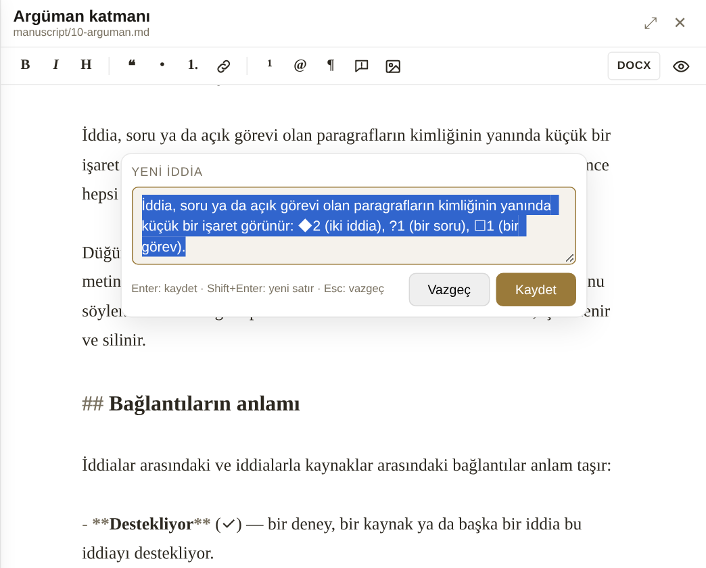

# Argüman katmanı

Kategoriler kitabın neyi *konu edindiğini* gösterir. **Argüman katmanı** ise neyi *savunduğunu*: iddiaları, hâlâ açık soruları ve yapılacak işleri. Bunların her biri kendi paragrafına bağlıdır; böylece harita ile metin birbirinden kopmaz.

## İddia, soru, görev

| | Nedir | Haritada |
|---|---|---|
| **İddia** | kitabın ileri sürdüğü bir önerme | düğüm |
| **Soru** | kitabın sorduğu ya da açık bıraktığı bir soru | düğüm |
| **Görev** | yapılacak bir iş ("kaynağı doğrula") | düğüm değil; metnin düğümüne ait |

İddiaların beş durumu vardır:

- **Taslak** — henüz karar verilmedi.
- **Desteklendi** — dayandığı deney, gözlem ya da kaynak metinde açıkça veriliyor.
- **Tez** — yazarın kendi önerisi; kaynakla değil, akıl yürütmeyle savunuluyor.
- **Tartışmalı** — literatürün kendisinin ayrıştığı bir görüş.
- **Bırakıldı** — artık savunulmuyor, kayıt için duruyor.

Soruların üç durumu vardır: **Açık**, **Yanıtlandı** ve **Kitabın ötesinde** (bilinçli olarak açık bırakılan, bu kitabın kapsamını aşan soru).

## Yakalamak

{#fig:iddia}

Yazarken imleç bir paragraftayken (ya da birkaç kelime seçiliyken):

- **Ctrl+Shift+K** — iddia
- **Ctrl+Shift+U** — soru
- **Ctrl+Shift+T** — görev

ya da araç çubuğundaki iddia düğmesinin menüsü. Küçük bir kutu açılır (@fig:iddia); seçili kelimeler ya da paragrafın ilk cümlesiyle başlar, düzeltip Enter'a basarsınız. Paragraf bir kimlik alır, iddia ya da soru haritada bölümün yanına düğüm olarak eklenir; imleç metinde kalır, yazmaya devam edersiniz. Esc vazgeçer. ^yakala

## Metindeki işaretler

İddia, soru ya da açık görevi olan paragrafların kimliğinin yanında küçük bir işaret görünür: ◆2 (iki iddia), ?1 (bir soru), ☐1 (bir görev). Üzerine gelince hepsi listelenir; tıklamak iddiayı haritada seçer.

Düğüm panelinde bir iddianın durumu değiştirilir ve **Pasaja git** onu metinde seçer. Pasaj metinden silinmiş ya da kimliği değişmişse panel bunu söyler. Görevler düğüm panelinin **Görevler** alanında eklenir, işaretlenir ve silinir.

## Bağlantıların anlamı

İddialar arasındaki ve iddialarla kaynaklar arasındaki bağlantılar anlam taşır:

- **Destekliyor** (✓) — bir deney, bir kaynak ya da başka bir iddia bu iddiayı destekliyor.
- **Çelişiyor** (✕) — iki öğe birbirine karşı duruyor; kitabın içindeki gerilimleri görünür kılar.
- **Kaynak** (❝) — iddianın dayandığı kişi, eser ya da kavram.
- **Yanıtlıyor** (↳) — bir iddia bir soruya yanıt veriyor; soru kapanmak zorunda değildir.
