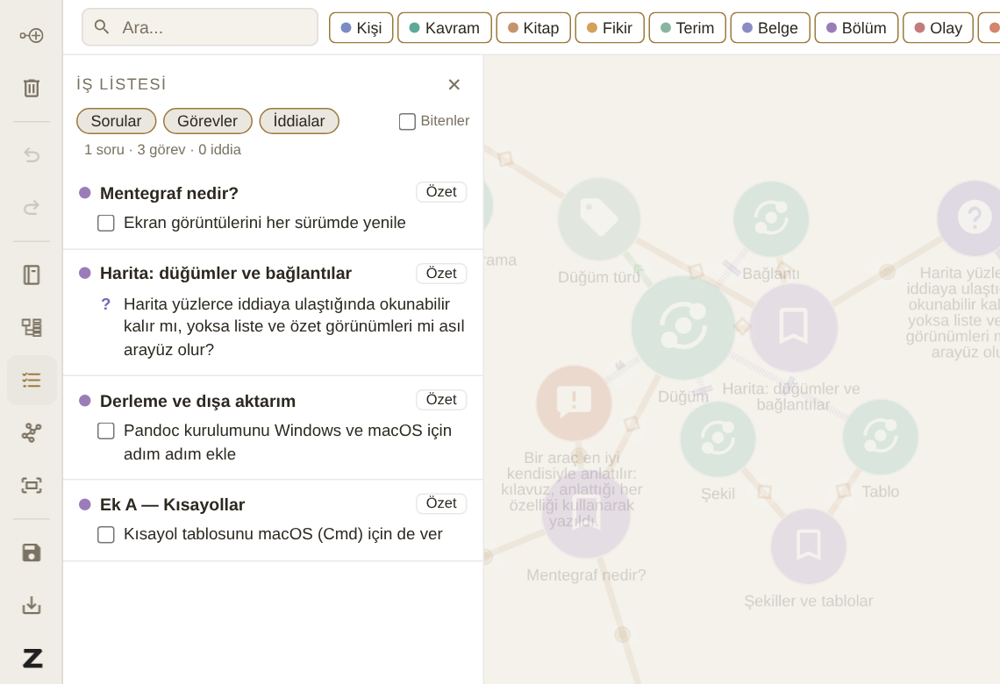
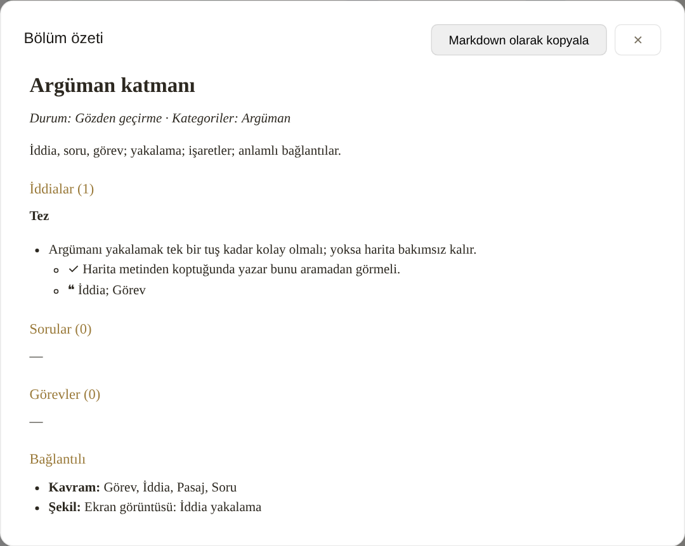

# İş listesi ve bölüm özeti

## İş listesi

{#fig:is-listesi}

Sol araç çubuğundaki **İş listesi** düğmesi kitapta yapılacak her şeyi tek yerde toplar (@fig:is-listesi):

- açık sorular,
- bitmemiş görevler,
- henüz karara bağlanmamış (Taslak) ya da Tartışmalı iddialar,
- pasajı metinden kaybolmuş iddia ve sorular (en üstte, "pasaj yok" işaretiyle).

Desteklendi ve Tez durumundaki iddialar ile Yanıtlandı ve Kitabın ötesinde durumundaki sorular listede yer almaz: bunlar yapılacak iş değildir.

Öğeler, kitap planındaki sırayla bölüm bölüm gruplanır. Üstteki düğmeler listeyi yalnızca sorulara, görevlere ya da iddialara daraltır; **Bitenler** tamamlanmışları da gösterir. Bir öğeye tıklamak paragrafını açar; bir görevin kutusunu işaretlemek onu tamamlar. Bir kategori filtresi açıksa liste yalnızca o kategoriye ait öğeleri gösterir.

İş listesi, haritanın metinden kopup kopmadığını da gösterir: bir paragrafı silip yeniden yazdığınızda o paragrafa bağlı iddia "pasaj yok" olarak burada belirir. Haritayı bakımlı tutmak için ayrıca bir şey yapmanız gerekmez; koptuğu yeri liste söyler. ^kopma

## Bölüm özeti

{#fig:ozet}

Metni olan her düğümün panelinde, ve iş listesinde her bölüm başlığının yanında, **Özet** düğmesi vardır. Özet (@fig:ozet) o bölüm hakkında haritanın bildiği her şeyi tek sayfada toplar:

- durum, kategoriler ve bölümün açıklaması,
- iddialar, durumlarına göre; her birinin altında onu destekleyen (✓), onunla çelişen (✕) ve dayandığı (❝) öğeler,
- sorular ve yanıtları,
- görevler,
- bölümün bağlı olduğu kişiler, kavramlar ve diğer düğümler, türlerine göre.

**Markdown olarak kopyala** özeti panoya alır; bir editöre, bir e-postaya ya da bir notlar dosyasına yapıştırılabilir. Yazmaya oturmadan önce bir bölümün özetine bakmak, o bölümde neyi savunduğunuzu ve neyin eksik olduğunu hatırlamanın en hızlı yoludur.
